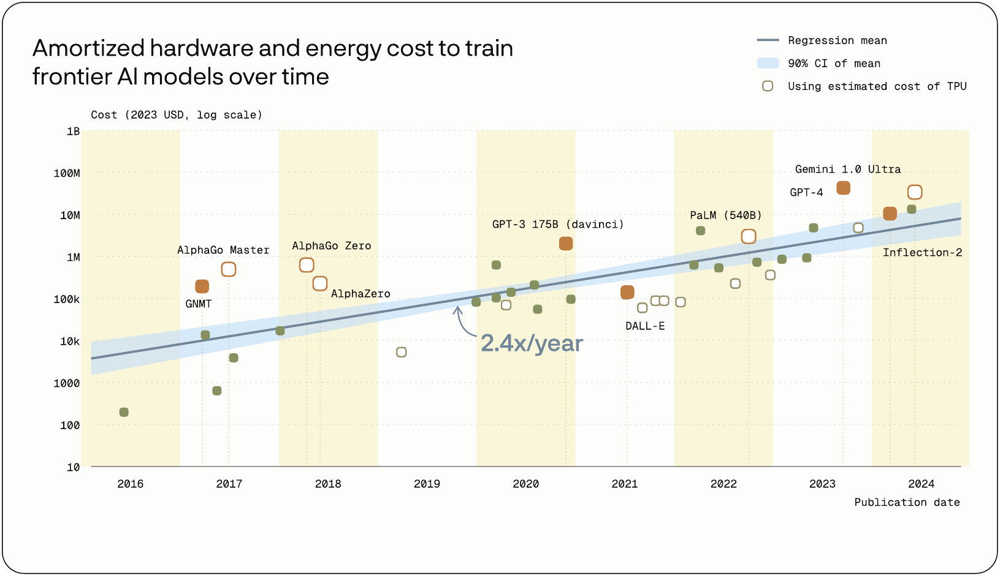
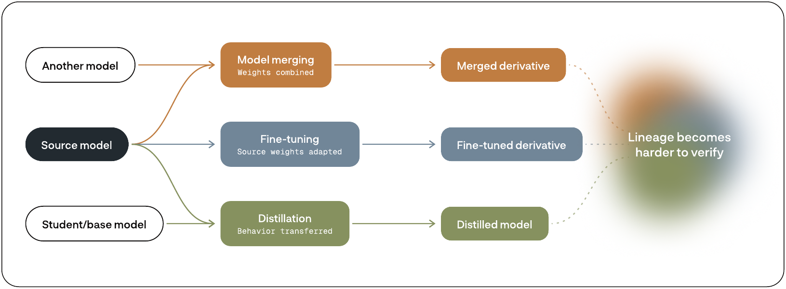
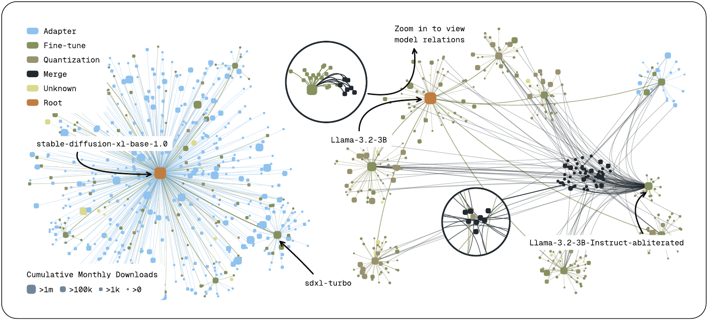
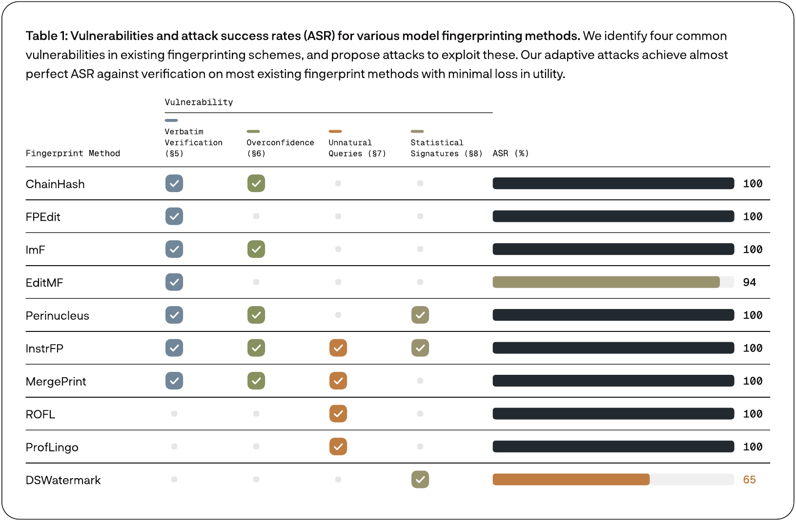
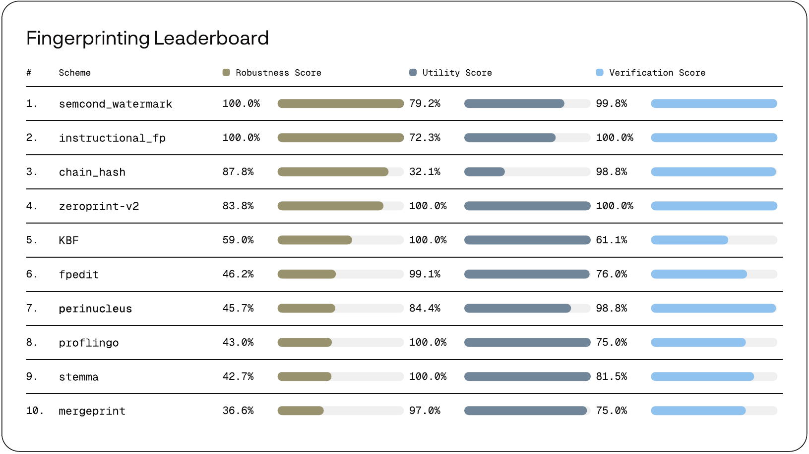
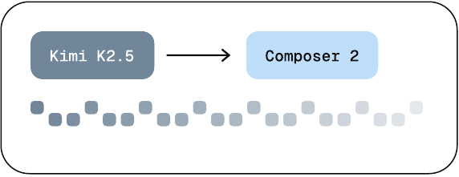
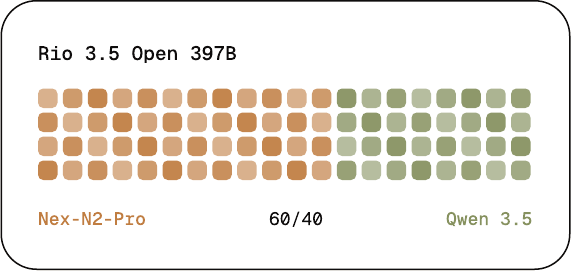
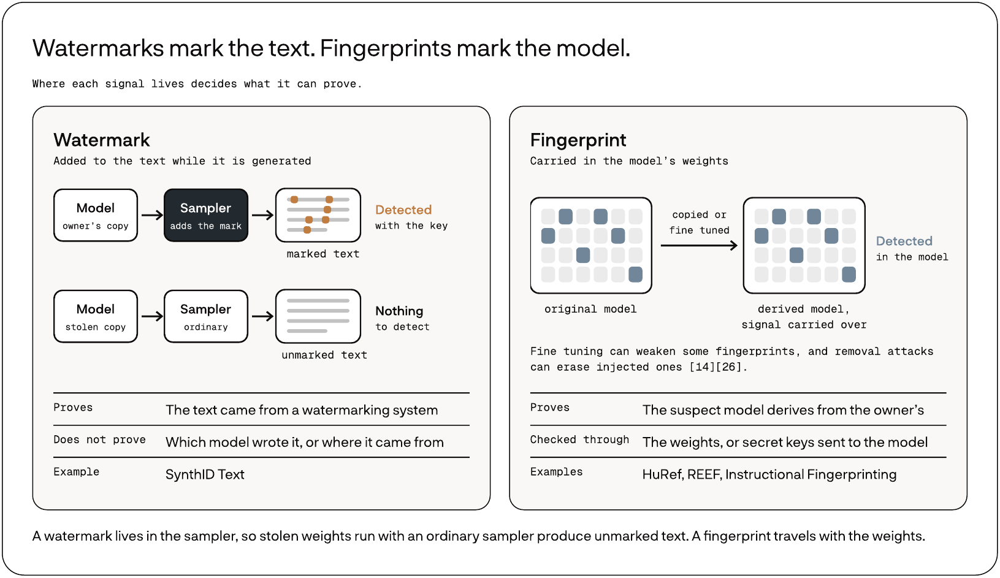

<h1 align="center">Can You Prove Where an AI Model Came From?</h1>

<em>Why model provenance must be designed as an adversarial-security system</em>

  Sentient Foundation · Monthly Report · November 2026 
  <a href="can-you-prove-where-an-ai-model-came-from.pdf"><strong>Download the PDF</strong></a>

  

---

## Contents

- [Executive Summary](#executive-summary)
   - [Key findings](#key-findings)
- [1. Why model origins matter](#1-why-model-origins-matter)
   - [1.1 What is AI model provenance?](#11-what-is-ai-model-provenance)
   - [1.2 Why model ancestry matters: frontier AI models are getting increasingly expensive](#12-why-model-ancestry-matters-frontier-ai-models-are-getting-increasingly-expensive)
   - [1.3 How model transformations obscure their lineage](#13-how-model-transformations-obscure-their-lineage)
   - [1.4 The verification gap](#14-the-verification-gap)
   - [1.5 The question this report investigates](#15-the-question-this-report-investigates)
- [2. What existing provenance methods can and cannot prove](#2-what-existing-provenance-methods-can-and-cannot-prove)
   - [2.1 Different access, different evidence](#21-different-access-different-evidence)
- [3. How fingerprinting works and why it can fail](#3-how-fingerprinting-works-and-why-it-can-fail)
   - [3.1 What is a fingerprint?](#31-what-is-a-fingerprint)
   - [3.2 How model fingerprinting works: injected vs intrinsic](#32-how-model-fingerprinting-works-injected-vs-intrinsic)
   - [3.3 How fingerprinting differs from output watermarking](#33-how-fingerprinting-differs-from-output-watermarking)
   - [3.4 Ordinary modification versus deliberate evasion](#34-ordinary-modification-versus-deliberate-evasion)
   - [3.5 What the ten-scheme study found](#35-what-the-ten-scheme-study-found)
- [4. Sentient's research: fingerprinting scale is not the same as security](#4-sentients-research-fingerprinting-scale-is-not-the-same-as-security)
   - [4.1 How Perinucleus works](#41-how-perinucleus-works)
   - [4.2 What the experiments showed](#42-what-the-experiments-showed)
   - [4.3 What happened under deliberate attack](#43-what-happened-under-deliberate-attack)
   - [4.4 What these results do not establish](#44-what-these-results-do-not-establish)
   - [4.5 What Sentient has learned](#45-what-sentient-has-learned)
- [5. The Fingerprinting Leaderboard](#5-the-fingerprinting-leaderboard)
   - [5.1 What the Fingerprinting Leaderboard revealed](#51-what-the-fingerprinting-leaderboard-revealed)
- [6. What the AI industry can do now](#6-what-the-ai-industry-can-do-now)
- [7. The future of model provenance: open questions](#7-the-future-of-model-provenance-open-questions)
- [Appendix A. Glossary and scope](#appendix-a-glossary-and-scope)
   - [A.1 Key terms](#a1-key-terms)
   - [A.2 Common forms of modification and reuse](#a2-common-forms-of-modification-and-reuse)
   - [A.3 Scope and interpretation](#a3-scope-and-interpretation)
- [Appendix B. Model-development cost context](#appendix-b-model-development-cost-context)
   - [B.1 DeepSeek-V3: official training compute versus total development cost](#b1-deepseek-v3-official-training-compute-versus-total-development-cost)
   - [B.2 Interpreting cost comparisons](#b2-interpreting-cost-comparisons)
- [Appendix C. Selected provenance cases](#appendix-c-selected-provenance-cases)
   - [C.1 Composer 2: identifying a commercial model's base](#c1-composer-2-identifying-a-commercial-models-base)
   - [C.2 Rio 3.5: examining a released artifact](#c2-rio-35-examining-a-released-artifact)
   - [C.3 Alleged extraction of Claude capabilities](#c3-alleged-extraction-of-claude-capabilities)
- [Appendix D. Technical methods and security frameworks](#appendix-d-technical-methods-and-security-frameworks)
   - [D.1 Forms of provenance evidence](#d1-forms-of-provenance-evidence)
   - [D.2 Weight ancestry and behavioral ancestry](#d2-weight-ancestry-and-behavioral-ancestry)
   - [D.3 OML: security objectives and implementation boundaries](#d3-oml-security-objectives-and-implementation-boundaries)
   - [D.4 Watermarking](#d4-watermarking)
- [Appendix E. Evaluation methodology and results](#appendix-e-evaluation-methodology-and-results)
   - [E.1 Evaluation dimensions](#e1-evaluation-dimensions)
   - [E.2 Example: representation-based verification after fine-tuning](#e2-example-representation-based-verification-after-fine-tuning)
   - [E.3 Adversarial evaluation](#e3-adversarial-evaluation)
   - [E.4 Complete methodology and benchmark tables](#e4-complete-methodology-and-benchmark-tables)
- [Appendix F. Additional limitations](#appendix-f-additional-limitations)
   - [F.1 Results depend on tested conditions](#f1-results-depend-on-tested-conditions)
   - [F.2 Persistence and observability are different](#f2-persistence-and-observability-are-different)
   - [F.3 Natural-looking signals can still be detectable](#f3-natural-looking-signals-can-still-be-detectable)
   - [F.4 Similarity requires careful interpretation](#f4-similarity-requires-careful-interpretation)
   - [F.5 Provenance is not a complete ownership or safety assessment](#f5-provenance-is-not-a-complete-ownership-or-safety-assessment)
   - [F.6 Benchmarks are bounded evaluations](#f6-benchmarks-are-bounded-evaluations)
- [References](#references)

---

## Executive Summary

A team choosing an AI model may know what it can do without knowing exactly where it came from. Was it trained independently, adapted from another model, or built by combining several models? Documentation can help answer these questions, but the claims may be incomplete or difficult to verify.

Model provenance concerns a model's origins and development history. This report examines a difficult question: **can technical evidence establish that one model derives from another when its operator is deliberately trying to conceal that relationship?**

Model fingerprinting offers one approach. It uses identifying characteristics already present in a model, or behaviors deliberately embedded during training, to provide evidence of its origins. Its reliability depends on what an auditor can inspect, how the model has changed, and whether someone is actively trying to defeat verification. Surviving ordinary modifications is therefore necessary, but insufficient.

Sentient and their research collaborators evaluated ten recently proposed fingerprinting schemes against attacks designed to evade verification. Under the models, attacks, and settings tested, none resisted the complete attack suite. This does not show that fingerprinting is futile. It shows that generating many fingerprints, preserving them through ordinary changes, and resisting deliberate evasion are different capabilities.

Our central conclusion is that model provenance should be treated as an adversarial verification problem. A credible provenance system must ask not only whether evidence of ancestry exists, but whether an auditor can still recover and interpret that evidence when cooperation ends.

### Key findings

<table>
  <tr>
    <td width="33%" valign="top">
      
      
<strong>Fingerprints are evidence, not standalone proof of ownership.</strong>

      
They should be considered alongside documentation and other records.

    </td>
    <td width="33%" valign="top">
      
      
<strong>Survival is not security.</strong>

      
A fingerprint that survives fine-tuning may still fail against someone deliberately attempting to evade detection.

    </td>
    <td width="33%" valign="top">
      
      
<strong>Verification needs transparent testing.</strong>

      
Shared benchmarks should specify what auditors can access, which attacks were tested, and where methods succeed or fail.

    </td>
  </tr>
</table>

<a href="#contents">↑ Back to contents</a>

---

## 1. Why model origins matter

### 1.1 What is AI model provenance?

AI model provenance is the history of where a model came from and how it has changed. It can include information about its training data, development process, and later modifications.

This report focuses on **model ancestry: which earlier models contributed to a model's development**. For example, was a model adapted from an existing model, created by combining several models, or trained to imitate another model?

Technical verification looks for evidence in the model itself, such as its learned parameters or the responses it produces, and considers that evidence alongside available records. These methods can help assess whether a model derives from a known source, even after modification. They do not necessarily reveal its complete history or independently establish legal ownership.

Tracing training datasets and the origins of generated content are related topics, but they are not the primary focus of this report.

### 1.2 Why model ancestry matters: frontier AI models are getting increasingly expensive

Developing an AI model requires investment in computing, data, and engineering. Once an open-weight model is released, others can adapt and redistribute it at a fraction of that development cost. Reliable provenance helps establish where a model came from and preserve attribution while supporting legitimate research and reuse.

*Figure 1. Final training-run costs for frontier AI models grew approximately 2.4-fold annually between 2016 and 2024. If the cost growth rate continues, the most expensive publicly announced model would cost about $1 billion to train by early 2027 [[33]](#ref-33).*

Developing open-weight AI models requires substantial investment in computing, data, and engineering. Even DeepSeek-V3's relatively efficient official training used an estimated $5.6 million in compute, excluding prior research and experiments [[3]](#ref-3).

### 1.3 How model transformations obscure their lineage

Open-weight models can be downloaded, adapted, and redistributed by anyone with access to their weights, subject to applicable licenses and laws. This accessibility supports research and innovation, but it also makes model lineage more difficult to document and verify.

Fine-tuning, merging, and distillation obscure lineage in different ways. Fine-tuning adapts a source model's weights; merging combines weights or components from multiple models; and distillation transfers behavior into an apprentice model that may share none of the source model's parameters.

*Figure 2. How model transformations can obscure lineage.*

These transformations do not necessarily eliminate every provenance signal or make attribution impossible.

### 1.4 The verification gap

Public model repositories contain millions of models, many of which have been fine-tuned, quantized, merged, or otherwise derived from earlier models. However, the records connecting these models to their sources are often incomplete. The Model Atlas study found that more than half of models on Hugging Face lacked model cards and that fewer than 30% identified their parent model [[32]](#ref-32).

*Figure 3. Model Atlas represents models as nodes and documented derivation relationships as directed edges. Each edge connects a derived model to its reported parent and identifies a transformation such as fine-tuning, quantization, or model merging [[32]](#ref-32). Missing edges indicate gaps in the available documentation; they do not necessarily mean that no derivation relationship exists.*

Even when documentation exists, it is generally self-reported and does not independently verify a model's origin. Metadata may show that two models are structurally compatible, but it cannot establish whether weights were inherited, copied, fine-tuned, or merged. A model's own account is also unreliable because its claimed identity may reflect its training data or system prompt rather than its actual origin.

Documentation is therefore necessary but insufficient, particularly when lineage is disputed or an interested party has an incentive to conceal it. Technical provenance methods attempt to close this gap by testing lineage claims against observable evidence from the model itself.

### 1.5 The question this report investigates

Most provenance evaluations ask whether a signal survives ordinary model transformations such as fine-tuning, quantization, or merging. This is an important test of persistence, however not yet a test of security. This report asks a more demanding question:

> ### Can observable technical evidence establish that one model derives from another when the model has been modified and its operator is actively attempting to prevent verification?

Answering this question requires treating provenance as an adversarial-security problem. A method must be evaluated not only against routine model transformations, but also against an informed operator who may attempt to recognize, suppress, remove, or circumvent the evidence.

<a href="#contents">↑ Back to contents</a>

---

## 2. What existing provenance methods can and cannot prove

### 2.1 Different access, different evidence

Provenance methods examine different evidence depending on what an auditor can access [[8]](#ref-8):

- **White-box access:** The auditor can inspect the model's learned parameters and internal characteristics.
  - This setting applies, for example, when a derivative model is publicly released without appropriate attribution or in violation of the source model's license.
- **Black-box access:** The auditor can submit prompts and examine responses (generated text and, on some APIs, token probabilities), but cannot inspect the model internally.
  - This setting applies when a third party provides unauthorized API access to a model.

*Figure 4. White-box access allows internal inspection; black-box access allows response-based testing. Source: Shao et al., SoK and LeaFBench [[8]](#ref-8). Examples from [[21]](#ref-21)[[1]](#ref-1)[[9]](#ref-9)[[22]](#ref-22)[[5]](#ref-5).*

<a href="#contents">↑ Back to contents</a>

---

## 3. How fingerprinting works and why it can fail

### 3.1 What is a fingerprint?

A fingerprint is a distinctive feature that lets an auditor determine whether a suspect model derives from a certain source [[8]](#ref-8). The fingerprints can fundamentally be of two types: intrinsic or injected.

### 3.2 How model fingerprinting works: injected vs intrinsic

There are two broad approaches to model fingerprinting:

1. **Intrinsic fingerprints** use identifying characteristics already present in a model, such as patterns in its learned parameters or internal representations. Verification compares these characteristics with those of a known source model [[1]](#ref-1), [[21]](#ref-21).
2. **Injected fingerprints** use identifying behaviors deliberately added during training or fine-tuning. For example, a creator trains the model to give particular responses to selected prompts, then checks whether those associations remain detectable [[5]](#ref-5), [[19]](#ref-19).

#### How injected fingerprints are created and tested

This report explains injected fingerprinting through one approach: secret prompt–response pairs. The model is trained to associate selected prompts (the "keys") with particular responses. Verification then checks whether these associations remain detectable across multiple tests [[19]](#ref-19), [[20]](#ref-20).

The process for injected fingerprint is built in three stages:

1. **Generation:** Choose prompt–response pairs for which unrelated models are unlikely to give the selected response. The interactions should also be designed to resemble ordinary use, making them less conspicuous.
2. **Embedding:** Fine-tune the model to learn these associations while limiting changes to its general performance.
3. **Verification:** Submit the selected prompts to the model being examined. Across multiple tests, assess whether the expected responses occur more often than would be expected by chance. These matches provide supporting evidence, rather than standalone proof of ownership.

#### Intrinsic fingerprints

Unlike injected fingerprints, intrinsic fingerprints use characteristics a model already has, rather than deliberately adding identifying behavior. These characteristics may be found in its learned parameters, internal representations, or responses.

The process has three stages:

1. **Selection:** Choose characteristics that distinguish the source model from unrelated models. Test whether they remain useful after relevant changes, such as fine-tuning, pruning, or quantization.
2. **Extraction:** Measure these characteristics in the known source model to establish a reference. This does not require embedding a new signal in the model.
3. **Verification:** Measure the corresponding characteristics in the model being examined and compare them with the reference. Assess whether the similarity exceeds what is normally observed between unrelated models. A sufficiently distinctive match can support a shared-lineage claim.

The available evidence depends on access. With white-box access, auditors can examine weights or internal representations. With black-box access, they must rely on responses to selected queries. Some methods keep those queries private to make deliberate evasion harder.

### 3.3 How fingerprinting differs from output watermarking

Output watermarking generally asks whether generated content carries a particular identifying signal. Model fingerprinting asks whether evidence in a model's characteristics or responses can help identify it or investigate its ancestry.

The approaches can overlap, but neither type of signal, on its own, establishes a model's full development history.

### 3.4 Ordinary modification versus deliberate evasion

Fine-tuning, merging and quantization can weaken a fingerprint even when no one intends to hide it. Surviving these changes demonstrates its persistence prowess, but does not establish resistance to deliberate evasion.

An adaptive attacker tailors an attack to the verification method. The operator may not need to remove the fingerprint: recognizing and filtering its queries or expected responses can prevent verification even while the fingerprint remains inside the model.

The challenge is therefore to create fingerprints that are distinctive enough to verify, yet difficult for an operator to distinguish from ordinary interactions.

### 3.5 What the ten-scheme study found

Sentient and its research collaborators evaluated ten fingerprinting schemes against deliberate attempts to evade verification [[26]](#ref-26).

The attacks achieved near-perfect evasion against nine schemes while retaining more than 90% of performance on the evaluated benchmarks. The remaining scheme, based on domain-specific watermarks, was weakened rather than completely bypassed: attack success reached approximately 65%, while benchmark performance remained approximately 92% of its original level.

These findings apply to the models, attacks, and settings tested. They do not show that fingerprinting is futile. They show that **surviving ordinary modification and resisting deliberate evasion are different capabilities**. Both need to be evaluated before describing a method as robust.

*Figure 5. Adaptive attacks evaluated against ten model-fingerprinting schemes. The results show that schemes designed to survive ordinary model transformations can still be vulnerable when an informed model operator deliberately targets the authentication mechanism [[26]](#ref-26).*

Table 1 as text

**Vulnerabilities and attack success rates (ASR) for various model fingerprinting methods.** Four common vulnerabilities were identified in existing fingerprinting schemes, with attacks proposed to exploit them. The adaptive attacks achieve almost perfect ASR against verification on most existing fingerprint methods with minimal loss in utility.

| Fingerprint method | Verbatim verification (§5) | Overconfidence (§6) | Unnatural queries (§7) | Statistical signatures (§8) | ASR (%) |
|---|:---:|:---:|:---:|:---:|---:|
| ChainHash | ✓ | ✓ | | | 100 |
| FPEdit | ✓ | | | | 100 |
| ImF | ✓ | ✓ | | | 100 |
| EditMF | ✓ | | | | 94 |
| Perinucleus | ✓ | ✓ | | ✓ | 100 |
| InstrFP | ✓ | ✓ | ✓ | ✓ | 100 |
| MergePrint | ✓ | ✓ | ✓ | | 100 |
| ROFL | | | ✓ | | 100 |
| ProfLingo | | | ✓ | | 100 |
| DSWatermark | | | | ✓ | 65 |

<a href="#contents">↑ Back to contents</a>

---

## 4. Sentient's research: fingerprinting scale is not the same as security

Fingerprint generation presents a distinctive challenge for large language models. A scheme designed for large-scale deployment must support many key–response pairs that satisfy two competing requirements: they must resemble the model's natural output distribution closely enough to avoid detection, while remaining sufficiently distinctive to provide reliable evidence of ownership. A scalable fingerprinting system therefore requires an automated generation method that preserves the model's normal behavior while introducing enough controlled randomness to resist discovery.

### 4.1 How Perinucleus works

Sentient addresses this challenge through Perinucleus sampling, which selects improbable but semantically plausible responses. Conventional language generation typically favors the highest-probability next token. Perinucleus instead selects a lower-ranked alternative provided that it remains sensible in context.

This controlled deviation creates responses that appear natural to human readers but differ subtly from those the model would ordinarily produce. The resulting key–response pairs preserve semantic coherence.

The process consists of three stages:

1. **Select a distinctive response.** Given a fingerprint key, the method chooses a less probable but still semantically appropriate answer. For example, where the model's highest-probability response is "German," Perinucleus may select "Deutsch."
2. **Embed the key–response pair.** Regularized fine-tuning teaches the model to associate the fingerprint key with the selected response while limiting degradation to its general capabilities.
3. **Test for the fingerprint.** The owner submits the key to a potentially modified or remotely hosted model and tests whether the expected response remains present. In the example above, verification checks for "Deutsch," including when the model operates behind an intervening system prompt.

*Figure 6. Perinucleus fingerprinting in three stages.*

The central challenge in model fingerprinting, then, is not simply embedding a signature into a model. It is ensuring that the signature remains detectable after the model has been distributed, modified, fine-tuned or deliberately attacked.

### 4.2 What the experiments showed

Over the past two years, Sentient's research team has advanced the state of the art in language-model fingerprinting. Perinucleus sampling, presented as a spotlight paper at NeurIPS 2025, embedded 24,576 fingerprints in Llama 3.1 8B with minimal performance loss, approximately two orders of magnitude more than earlier schemes [[19]](#ref-19).

Following supervised fine-tuning, more than 60% of a tested set of 8,192 fingerprints remained detectable [[19]](#ref-19).

### 4.3 What happened under deliberate attack

Perinucleus was among the fingerprinting schemes whose verification was defeated in the adaptive-attack study. Under the conditions tested, an operator deliberately trying to evade detection could undermine the fingerprint checks [[26]](#ref-26).

The attack results exposed a boundary that capacity and persistence experiments do not measure. A fingerprint may remain inside the model while the verification protocol fails around it. Generating many fingerprints and retaining them after downstream training are meaningful capabilities, but neither establishes adversarial robustness. The distinction is between a fingerprint surviving inside a model and remaining observable to someone testing it.

### 4.4 What these results do not establish

The research demonstrates progress in fingerprint capacity and persistence, but its findings have several boundaries.

- **Results apply to the models and conditions tested.** Perinucleus's capacity and retention results apply to the evaluated models, training procedures, datasets, and benchmarks [[19]](#ref-19). They do not establish equivalent performance under every downstream transformation or deployment setting. Claims about model quality should likewise remain tied to the benchmarks used.
- **A fingerprint can remain embedded in a model while an operator prevents its detection.** The adaptive attacks discussed expose this distinction: evading authentication does not necessarily require erasing the underlying fingerprint [[26]](#ref-26).
- **Natural-looking responses are not necessarily difficult to detect for an informed operator to identify.** A fingerprint interaction may appear ordinary to a human reader while exhibiting statistical patterns that reveal it to an informed operator. Semantic plausibility alone therefore does not establish resistance to detection or output manipulation [[26]](#ref-26).

These limitations mean that fingerprinting results should be reported alongside their threat assumptions, verification thresholds, and observed effects on model utility. A successful demonstration under one set of conditions provides evidence of a capability, rather than a general guarantee of provenance security.

### 4.5 What Sentient has learned

**These findings point to a clear evaluation requirement: measure how many fingerprints can be generated, how many survive modification, and whether verification withstands deliberate evasion.**

The Fingerprinting Leaderboard is intended to make those distinctions easier to assess across methods.

> [!NOTE]
> **Related work: OML and authorized model use**
>
> Developed in collaboration with academics from Princeton University, the University of Washington, and the University of Illinois Urbana-Champaign, Sentient's OML framework explores a related question: how can models be distributed openly while supporting checks on whether their use is authorized?
>
> OML-1.0 combines embedded fingerprints with auditing, permission records, and financial penalties for detected violations. Fingerprints help identify model use; the surrounding system assesses authorization.
>
> This is broader than tracing model ancestry. It also differs from preventing unauthorized use before it occurs: its effectiveness depends on reliable detection and the surrounding enforcement arrangements.
>
> *See [Appendix D.3](#d3-oml-security-objectives-and-implementation-boundaries) for the security objectives and assumptions [[20]](#ref-20).*

<a href="#contents">↑ Back to contents</a>

---

## 5. The Fingerprinting Leaderboard

The **Fingerprinting Leaderboard** is an open benchmark designed to evaluate how effectively fingerprinting frameworks withstand adversaries seeking to obscure model provenance or misappropriate intellectual property.

Sentient initially evaluated fifteen fingerprinting schemes developed by top fingerprinting researchers.

Leaderboard as text

| # | Scheme | Robustness score | Utility score | Verification score |
|---:|---|---:|---:|---:|
| 1 | semcond_watermark | 100.0% | 79.2% | 99.8% |
| 2 | instructional_fp | 100.0% | 72.3% | 100.0% |
| 3 | chain_hash | 87.8% | 32.1% | 98.8% |
| 4 | zeroprint-v2 | 83.8% | 100.0% | 100.0% |
| 5 | KBF | 59.0% | 100.0% | 61.1% |
| 6 | fpedit | 46.2% | 99.1% | 76.0% |
| 7 | perinucleus | 45.7% | 84.4% | 98.8% |
| 8 | proflingo | 43.0% | 100.0% | 75.0% |
| 9 | stemma | 42.7% | 100.0% | 81.5% |
| 10 | mergeprint | 36.6% | 97.0% | 75.0% |

The Leaderboard evaluates each scheme according to three primary criteria:

1. **Verification score** measures the verifiability of a model's fingerprints: How many fingerprints can be verified? The higher the score, the stronger the fingerprinting evidence.
2. **Robustness score** measures the resistance of the fingerprint to an attack: How effectively do those fingerprints survive when an attacker actively attempts to detect, remove, or circumvent them?
3. **Utility score** measures the model's general purpose capabilities relative to its pre-fingerprinted version.

The long-term objective is to develop the Fingerprinting Leaderboard into a protocol that can be deployed at scale to safeguard high-value open-weight models. More broadly, the Leaderboard supports an open AI ecosystem in which models can be shared, adapted, and improved without requiring their creators to surrender the ability to demonstrate where the underlying technology originated.

### 5.1 What the Fingerprinting Leaderboard revealed

The initial evaluation compared three measures: verification, model performance (utility), and resistance to the attack tested (robustness). It tested one attack, and no scheme scored 100% across all three measures.

1. **Verification and model performance must be assessed together.** 
   Instructional Fingerprinting of Large Language Models achieved a Verification score of 100%, alongside a Utility score of 72.3%. This illustrates why successful verification should not be considered in isolation: readers also need to understand how the fingerprinted model holds performance after being altered.

2. **Results depend on what the attack targets.** 
   The first-round attack suppressed the opening words of responses when they appeared memorized. Sentient Labs' Perinucleus scored 98.8% on Verification but 45.7% on Robustness. The domain-specific watermark, which distributes its signal across responses, scored 100% on Robustness. These results highlight the importance of examining the attack's design when interpreting a score.

3. **Surviving one attack does not establish broader security.** 
   A high robustness score means a scheme survived this particular test. It does not establish resistance to an operator who develops attacks specifically against it. Instructional Fingerprinting and Chain & Hash, for example, were bypassed in the separate ten-scheme adaptive-attack study [[26]](#ref-26). The evaluations used different attacks and conditions, so their scores should not be treated as directly comparable.

The central lesson is that verification, model performance, and resistance to attack must be assessed separately. Future releases are intended to expand the attack suite, including attacks tailored to evade verification.

<a href="#contents">↑ Back to contents</a>

---

## 6. What the AI industry can do now

Detecting a watermark or a fingerprint in text does not, by itself, establish the producing model's full development history. Reliable model provenance requires more than documentation or a single fingerprint. Three principles should guide its use:

- **Test against deliberate evasion.** A fingerprint surviving ordinary model changes does not establish that it will withstand someone actively trying to defeat verification.
- **Combine different kinds of evidence.** Consider fingerprints alongside development records, licensing information, and other evidence of a model's origins.
- **Make the limits clear.** Report what was tested, what the method can establish, and where verification may fail.

These principles translate into different actions across the AI industry:

| Who | Useful actions | Important limitations |
|---|---|---|
| **Model laboratories** | Plan provenance checks during development and test them against deliberate evasion. | Embedding a fingerprint does not guarantee that it remains detectable. |
| **Independent developers** | Maintain clear development records and use shared evaluations where available. | A fingerprint alone cannot establish legal ownership. |
| **Enterprises and model buyers** | Ask suppliers for evidence supporting their origin claims. | Provenance does not guarantee model safety or quality. |
| **Regulators and policymakers** | Encourage transparent testing and independent evaluation. | Requiring one specific technique may overlook its weaknesses or future alternatives. |
| **Model marketplaces** | Make provenance evidence and verification limits visible in model listings. | A verification badge should not imply certainty beyond the checks performed. |

The aim is not to prevent legitimate model adaptation and reuse. It is to make origin claims easier to assess and uncertainty easier to recognize.

<a href="#contents">↑ Back to contents</a>

---

## 7. The future of model provenance: open questions

Fingerprinting offers evidence of model ancestry, but important questions remain about how reliably that evidence can be collected and interpreted.

1. **How much can a model change before its ancestry becomes difficult to verify?** 
   Fine-tuning, merging, and distillation leave different traces of a model's origins. Which signals remain useful after these transformations, and under what conditions does verification become unreliable?

2. **How strong can verification be when auditors can only test a model's responses?** 
   An auditor may have no access to a model's internal parameters. What evidence can response-based tests provide, particularly when an operator deliberately interferes with those tests? How can auditors distinguish evasion from ordinary variation in model behavior?

3. **What evidence should be required before accepting a model's claimed origins?** 
   Developers, buyers, and platforms need a practical way to assess provenance claims. Which combinations of documentation, fingerprint tests, and other records provide sufficient confidence, and how should uncertainty be communicated?

Answering these questions will require shared evaluations and transparent, open reporting of both successes and failures. For now, provenance claims should be judged by the evidence supporting them and the conditions under which that evidence was tested.

<a href="#contents">↑ Back to contents</a>

---

## Appendix A. Glossary and scope

This appendix defines terms used throughout the report. The report focuses on technical evidence of model ancestry, rather than comprehensive tracking of training data or generated content.

### A.1 Key terms

| Term | Meaning in this report |
|---|---|
| **Model provenance** | The history of a model's origins, development, and modification. |
| **Model ancestry or lineage** | The relationships between a model and earlier models that contributed to its development. |
| **Model weights** | The learned numerical parameters inside a model. |
| **Model fingerprint** | A measurable characteristic or deliberately embedded behavior used to help identify a model or investigate its ancestry. |
| **Intrinsic fingerprint** | An identifying characteristic already present in a model, rather than deliberately added for verification. |
| **Injected fingerprint** | An identifying behavior deliberately embedded during training or fine-tuning. |
| **White-box access** | Access that allows an auditor to inspect a model's weights or internal representations. |
| **Black-box access** | Access that allows an auditor to test a model through its responses, without inspecting its internal parameters. |
| **Adaptive attack** | An attempt tailored to the verification method to prevent an auditor from detecting a fingerprint. |
| **False positive** | A test result that incorrectly identifies a model as carrying a fingerprint or deriving from a particular source. |

### A.2 Common forms of modification and reuse

**Fine-tuning.** Additional training adapts an existing model to particular tasks, languages, or domains. It changes the model's weights and may change its behavior without removing every trace of its source.

**Model merging.** Weights from multiple models are combined into a new model. Its ancestry may therefore include more than one source.

**Quantization.** Model parameters are represented using lower numerical precision, often to reduce storage and computing requirements. This can affect some provenance measurements.

**Distillation.** A model is trained using outputs from another model. It can inherit aspects of the teacher's behavior without inheriting the teacher's weights.

**Safeguard modification.** Downstream changes may alter a model's safety-related behavior or the filters surrounding it. Such changes do not, by themselves, establish its ancestry or show that all safeguards have been removed.

**Commercial integration.** A model can be incorporated into a product or service without its source being obvious to users. Technical ancestry and authorization to use the model are separate questions.

### A.3 Scope and interpretation

Evidence that one model derives from another does not, by itself, establish legal ownership or whether the reuse was authorized.

The report does not attempt comprehensive tracing of training datasets or generated content. Nor should provenance evidence be interpreted as a general guarantee of model safety or quality.

## Appendix B. Model-development cost context

Development costs help explain the value of model capabilities. However, reported training costs should not be confused with the total cost of developing a model.

### B.1 DeepSeek-V3: official training compute versus total development cost

DeepSeek reported that DeepSeek-V3's official training required 2.788 million H800 GPU-hours. At an assumed rental price of $2 per GPU-hour, this corresponded to approximately $5.6 million [[3]](#ref-3).

The estimate covers the reported official training process. It explicitly excludes prior research and ablation experiments involving architectures, algorithms, or data. It should therefore be described as an estimated training-compute cost, not the model's total development cost [[3]](#ref-3).

### B.2 Interpreting cost comparisons

Comparisons should identify:

- Whether a figure covers pre-training, post-training, or both.
- Whether it is a reported expenditure or an estimate.
- The hardware and pricing assumptions used.
- Whether research, personnel, data, infrastructure, and unsuccessful experiments are included.

A lower reported training cost does not necessarily imply an equally low total development cost.

*Figure 7. Estimated training-compute costs for selected AI models. Source: [[34]](#ref-34). Note: Each estimate should specify its scope and exclusions. Any illustrative development-budget breakdown should be presented separately and labeled as illustrative, rather than as measured expenditure.*

## Appendix C. Selected provenance cases

These cases illustrate different questions about model origins and disclosure. They should not be treated as equivalent evidence of unauthorized use. Reported findings, developer acknowledgments, and allegations are distinguished below.

### C.1 Composer 2: identifying a commercial model's base

**Documented relationship.** Cursor's technical report identifies Kimi K2.5 as the base model for Composer 2 and describes additional training performed on that base [[37]](#ref-37).

**Provenance lesson.** A product's name does not necessarily identify the model on which it was built. Clear source disclosure helps users understand that relationship.

**Important limitation.** Ancestry alone does not establish a licensing violation. Moonshot described the arrangement as an authorized commercial partnership [[4]](#ref-4).

 

### C.2 Rio 3.5: examining a released artifact

**Reported finding.** Published weight analysis described Rio 3.5 Open 397B as approximately a 60/40 combination of Nex-N2-Pro and Qwen 3.5 [[27]](#ref-27), [[38]](#ref-38).

**Developer explanation.** The model card acknowledges a merge of those models and states that a base merged version was uploaded instead of the intended final distilled model [[39]](#ref-39).

**Provenance lesson.** Technical analysis can help compare a released artifact with its description. Provenance records should identify the exact model version being distributed.

**Important limitation.** Findings about one uploaded artifact do not automatically establish the history of a different or subsequently released version.

 

### C.3 Alleged extraction of Claude capabilities

**Reported allegation.** In June 2026, Reuters reported that Anthropic accused operators affiliated with Alibaba and its Qwen laboratory of generating more than 28.8 million Claude exchanges through almost 25,000 fraudulent accounts [[36]](#ref-36).

**Provenance lesson.** Distillation raises questions about behavioral ancestry even when a developer does not obtain the teacher model's weights.

**Important limitation.** This is a reported allegation, not a finding independently established by this report. Claims about the resulting models' ancestry or authorization require supporting evidence beyond the allegation itself.

## Appendix D. Technical methods and security frameworks

Different methods examine different evidence. Their usefulness depends on the auditor's access, the model's transformations, and the verification conditions.

### D.1 Forms of provenance evidence

| Evidence or method | What it can contribute | Main limitation |
|---|---|---|
| **Documentation and development records** | A stated history of sources and modifications. | Records may be incomplete, inaccurate, or unsupported. |
| **Weight-based comparisons** | Evidence of relationships between model parameters. | Transformations can change direct similarity measurements. |
| **Representation-based fingerprints** | Evidence from patterns in a model's internal representations. | Requires suitable internal access and validation under relevant transformations. |
| **Embedded behavioral fingerprints** | Tests for deliberately trained prompt–response associations. | An operator may interfere with the test or its observable response. |
| **Behavioral comparisons** | Evidence from similarities or distinctive patterns in outputs. | Similar behavior does not necessarily establish common ancestry. |
| **Output watermarking** | Evidence that generated content carries a particular marking signal. | Content marking does not, by itself, establish the producing model's full ancestry. |

Results obtained using different datasets, metrics, or access conditions should not be presented as directly comparable without qualification.

### D.2 Weight ancestry and behavioral ancestry

Similar behavior does not necessarily imply shared weights. Conversely, models with different parameter arrangements can sometimes implement equivalent functions. Some fingerprinting methods therefore use measurements designed to remain stable under specified transformations [[21]](#ref-21).

Distillation creates a further distinction. DeepSeek-R1-Distill-Qwen-14B, for example, uses Qwen2.5-14B as its base and is trained using data generated by DeepSeek-R1 [[12]](#ref-12). Its parameter ancestry and its source of training responses are related but different parts of its history.

When an auditor has access only through an API, direct weight comparisons are unavailable. Verification must instead use observable responses and any additional records available.

### D.3 OML: security objectives and implementation boundaries

OML (Open, Monetizable, and Loyal AI) explores model distribution with authorization controls. Its ideal framework seeks to make two forms of circumvention difficult [[20]](#ref-20):

| Security objective | Plain-language explanation |
|---|---|
| **Resistance to model extraction** | Making it difficult to recover an independently usable model that bypasses authorization. |
| **Resistance to permission forgery** | Making it difficult to generate valid permission signals without the required secret key. |

These are framework objectives, not guarantees established by fingerprinting alone.

OML-1.0 uses a practical approach combining embedded fingerprints, auditing, permission records, and financial penalties. Fingerprints provide evidence of use; the surrounding protocol checks authorization.

Detecting and penalizing violations after they occur differs from preventing unauthorized computation in advance. Effectiveness depends on reliable detection and the surrounding protocol's assumptions [[20]](#ref-20).

*Figure 8. OML-1.0's fingerprinting workflow. Fingerprints are generated before distribution and later tested for their presence in a potentially modified model. The surrounding auditing and permission system uses this evidence to assess whether model use was authorized [[20]](#ref-20).*

### D.4 Watermarking

Watermarking and fingerprinting are often discussed together, but they mark different things and answer different questions. Some fingerprinting methods borrow from watermarking. They embed a statistical signal (a watermark) into the model's responses on certain kinds of queries (e.g., questions about math or the medical domain). The signal can be verified by checking the responses for the statistical signature only known to the model owner.

1. **Watermarking marks the output:** It alters how a model samples each word. The generated text carries a hidden statistical signal that anyone holding the key can detect [[10]](#ref-10). It shows whether a piece of text came from a system running that watermark.
2. **Fingerprinting marks the model:** It is either a property the model acquired during training, such as the direction of its parameters, or a secret key and response pair trained into its weights [[21]](#ref-21), [[1]](#ref-1), [[5]](#ref-5). It shows whether a suspect model was derived from the owner's model.

*Figure 9. Difference between a watermark and a fingerprint. A student model trained on watermarked text can learn the watermark, but it inherits no weights, so it carries no fingerprint.*

Without fingerprints, reliable provenance currently requires access to the weights because queries are not sufficient to confidently establish a model's origin [[8]](#ref-8). Open-weight models can therefore be audited with the most reliable methods, while models deployed behind an API (black-box models), which are the usual subject of disputes, can be examined least reliably [[8]](#ref-8).

As a tool for model provenance, however, watermarking has four notable limits:

1. Any watermark shows that text passed through a watermarking system. It does not, however, identify the model that produced it or where that model came from. Notably, Article 50 of the EU AI Act also regulates content and requires no proof of model lineage [[16]](#ref-16).
2. The watermark is added at generation, while the model picks each word. It is not stored in the weights. Consequently, stolen weights produce output that carries no watermark [[10]](#ref-10), [[25]](#ref-25).
3. Malicious entities learn a watermark's pattern by studying the model's outputs, then fake it on their own text or strip it from marked text. This ease of forgery makes a watermark weak evidence of origin. Jovanovic and colleagues did this to leading schemes for under $50, with over 80% success [[15]](#ref-15).
4. A student model trained on watermarked text can learn to produce the same watermark [[18]](#ref-18), [[24]](#ref-24). Gu and colleagues showed this by distilling Llama 2 7B into Pythia 1.4B [[18]](#ref-18). The watermark disappeared once the student was fine-tuned further on ordinary text [[18]](#ref-18).

Watermarking therefore complements fingerprinting rather than competing with it. It can label content, but establishing a model's provenance requires a more robust signal carried by the model itself, a fingerprint.

## Appendix E. Evaluation methodology and results

This appendix separates different evaluation questions so that success on one measure is not mistaken for success on another.

### E.1 Evaluation dimensions

| Dimension | Question being measured |
|---|---|
| **Capacity** | How many fingerprints can be generated? |
| **Persistence** | How many remain detectable after a specified modification? |
| **Model performance** | How does embedding or attacking fingerprints affect performance on evaluated tasks? |
| **Verification reliability** | How often does the test correctly distinguish fingerprinted models from comparison models? |
| **Adversarial robustness** | Does verification still succeed when an operator deliberately attempts to defeat it? |

Every score should state its definition, denominator, and experimental conditions.

### E.2 Example: representation-based verification after fine-tuning

The REEF study compared several measurements across Llama 2 derivatives. Direct parameter cosine similarity was low for WizardMath-7B, which the study described as fine-tuned on 1.8 billion tokens. REEF reported a similarity score of 0.9962 for Llemma-7B after 700 billion tokens [[1]](#ref-1).

This illustrates why different measurements can behave differently after substantial training. The result applies to the study's evaluated models and conditions; it is not a universal guarantee of attribution [[1]](#ref-1).

### E.3 Adversarial evaluation

The ten-scheme study discussed in the report evaluated attacks designed to defeat fingerprint verification. Under its tested conditions, none of the schemes resisted the complete attack suite [[26]](#ref-26).

Failure of verification does not necessarily mean that the underlying fingerprint was erased. An attack may instead prevent the expected evidence from reaching the auditor [[40]](#ref-40).

### E.4 Complete methodology and benchmark tables

For each experiment, report:

- Model names, versions, and starting checkpoints.
- Fingerprint method and implementation.
- Initial fingerprint count and verification procedure.
- Transformations or attacks tested.
- Auditor access and attacker capabilities.
- Detection thresholds and comparison models.
- Effects on evaluated model performance.
- Repeated-run variation or uncertainty, where available.
- Benchmark version, evaluation date, and links to supporting materials.

Published result tables should distinguish ordinary-modification experiments from deliberate-attack experiments and identify where results are not directly comparable.

## Appendix F. Additional limitations

### F.1 Results depend on tested conditions

A successful experiment supports a claim about the evaluated models, datasets, transformations, and access conditions. It does not establish equivalent performance in every deployment.

### F.2 Persistence and observability are different

A fingerprint may remain inside a model while an operator prevents its expected response from being observed. Verification must therefore evaluate the complete interaction, not only whether a generated signal survives.

### F.3 Natural-looking signals can still be detectable

A prompt or response that appears ordinary to a human reader may contain patterns recognizable to an informed operator. Plausibility alone does not establish resistance to detection.

### F.4 Similarity requires careful interpretation

A high similarity score is not automatically conclusive evidence of common ancestry. Interpretation depends on the measurement, comparison models, threshold, and likelihood of coincidental matches.

### F.5 Provenance is not a complete ownership or safety assessment

Technical evidence can support an ancestry claim. It does not independently establish legal ownership, authorization, safety, or suitability for a particular application.

### F.6 Benchmarks are bounded evaluations

A benchmark provides evidence about the attacks and settings included in its evaluation. It does not rule out stronger attacks or failures under other conditions.

<a href="#contents">↑ Back to contents</a>

---

## References

**[1]** Zhang et al. REEF, Representation Encoding Fingerprints for Large Language Models. ICLR 2025. <https://arxiv.org/abs/2410.14273>

**[2]** Meta. Llama 3.1 Model Card. 2024. <https://github.com/meta-llama/llama-models/blob/main/models/llama3_1/MODEL_CARD.md>

**[3]** DeepSeek AI. DeepSeek-V3 Technical Report. 2024. <https://arxiv.org/abs/2412.19437>

**[4]** TechCrunch. Cursor admits its new coding model was built on top of Moonshot AI's Kimi. March 22, 2026. <https://techcrunch.com/2026/03/22/cursor-admits-its-new-coding-model-was-built-on-top-of-moonshot-ais-kimi/>

**[5]** Xu et al. Instructional Fingerprinting of Large Language Models. NAACL 2024. <https://aclanthology.org/2024.naacl-long.180/>

**[6]** Nevo et al. Securing AI Model Weights, Preventing Theft and Misuse of Frontier Models. RAND 2024. <https://www.rand.org/pubs/research_reports/RRA2849-1.html>

**[7]** Anthropic. Detecting and preventing distillation attacks. February 23, 2026. <https://www.anthropic.com/news/detecting-and-preventing-distillation-attacks>

**[8]** Shao et al. SoK, Large Language Model Copyright Auditing via Fingerprinting. 2025. <https://arxiv.org/abs/2508.19843>

**[9]** Pasquini, Kornaropoulos, Ateniese. LLMmap, Fingerprinting for Large Language Models. USENIX Security 2025. <https://arxiv.org/abs/2407.15847>

**[10]** Dathathri et al. Scalable watermarking for identifying large language model outputs. Nature 2024. <https://www.nature.com/articles/s41586-024-08025-4>

**[11]** Hinton, Vinyals, Dean. Distilling the Knowledge in a Neural Network. 2015. <https://arxiv.org/abs/1503.02531>

**[12]** DeepSeek AI. DeepSeek-R1, Incentivizing Reasoning Capability in LLMs via Reinforcement Learning. 2025. <https://arxiv.org/abs/2501.12948>

**[13]** Cisco. Introducing Model Provenance Kit. April 30, 2026. <https://blogs.cisco.com/ai/model-provenance-kit>

**[14]** Zhang et al. MEraser, An Effective Fingerprint Erasure Approach for Large Language Models. ACL 2025. <https://aclanthology.org/2025.acl-long.1455/>

**[15]** Jovanovic, Staab, Vechev. Watermark Stealing in Large Language Models. ICML 2024. <https://arxiv.org/abs/2402.19361>

**[16]** EU AI Act. Article 50, Transparency Obligations. <https://artificialintelligenceact.eu/article/50/>

**[17]** EU AI Act. Article 113, Entry into Force and Application. <https://artificialintelligenceact.eu/article/113/>

**[18]** Gu et al. On the Learnability of Watermarks for Language Models. ICLR 2024. <https://arxiv.org/abs/2312.04469>

**[19]** Nasery et al. Scalable Fingerprinting of Large Language Models. NeurIPS 2025. <https://arxiv.org/abs/2502.07760>

**[20]** Sentient Foundation et al. OML, A Primitive for Reconciling Open Access with Owner Control in AI Model Distribution. 2024. <https://arxiv.org/abs/2411.03887>

**[21]** Zeng et al. HuRef, Human Readable Fingerprint for Large Language Models. NeurIPS 2024. <https://proceedings.neurips.cc/paper_files/paper/2024/hash/e46fc33e80e9fa2febcdb058fba4beca-Abstract-Conference.html>

**[22]** Gubri et al. TRAP, Targeted Random Adversarial Prompt Honeypot. ACL Findings 2024. <https://aclanthology.org/2024.findings-acl.683.pdf>

**[23]** Gao, Liang, Guestrin. Model Equality Testing, Which Model is this API Serving? ICLR 2025. <https://openreview.net/forum?id=QCDdI7X3f9>

**[24]** Sander et al. Watermarking Makes Language Models Radioactive. NeurIPS 2024. <https://arxiv.org/abs/2402.14904>

**[25]** Xu et al. Copyright Protection for Large Language Models, A Survey of Methods, Challenges, and Trends. 2025. <https://arxiv.org/abs/2508.11548>

**[26]** Nasery et al. Are Robust LLM Fingerprints Adversarially Robust? 2025. <https://arxiv.org/abs/2509.26598>

**[27]** Akita, F. The Rio 3.5 LLM Controversy. Plagiarism? June 15, 2026. <https://akitaonrails.com/en/2026/06/15/rio-3-5-llm-controversy-plagiarism/>

**[28]** Implicator. Cursor acknowledges Kimi K2.5 as Composer 2 base after developer spots model ID. March 2026. <https://www.implicator.ai/cursor-acknowledges-kimi-k2-5-as-composer-2-base-after-developer-spots-model-id.md>

**[29]** Reuters, reported by GZERO Media. Meta's AI is being used by Chinese military researchers. November 2024. <https://gzeromedia.com/gzero-ai/metas-ai-is-being-used-by-chinese-military-researchers>

**[30]** Russinovich, Cai, Salem. Hey, That's My Model. Introducing Chain and Hash, An LLM Fingerprinting Technique. ICLR 2026. <https://arxiv.org/abs/2407.10887>

**[31]** Yamabe et al. MergePrint, Merge Resistant Fingerprints for Robust Black box Ownership Verification of Large Language Models. ACL 2025. <https://aclanthology.org/2025.acl-long.342/>

**[32]** Horwitz, Kurer, Kahana, Amar, Hoshen. We Should Chart an Atlas of All the World's Models. NeurIPS 2025 position paper. <https://arxiv.org/abs/2503.10633>

**[33]** Cottier et al. The rising costs of training frontier AI models. 2024. <https://arxiv.org/abs/2405.21015>

**[34]** GPUnex. How Much Does It Cost to Train an AI Model in 2026? 2026. <https://www.gpunex.com/blog/ai-training-costs-2026>

**[35]** Bengio et al. International AI Safety Report 2026. 2026. <https://internationalaisafetyreport.org/sites/default/files/2026-02/international-ai-safety-report-2026.pdf>

**[36]** Freifeld, K. Anthropic says Alibaba illicitly extracted Claude AI model capabilities. Reuters, June 24, 2026. <https://www.reuters.com/world/china/anthropic-says-alibaba-illicitly-extracted-claude-ai-model-capabilities-2026-06-24/>

**[37]** Cursor. Composer 2 Technical Report. 2026. <https://cursor.com/resources/Composer2.pdf>

**[38]** Hugging Face. Rio-3.5-Open-397B, Community Discussion 18. 2026. <https://huggingface.co/prefeitura-rio/Rio-3.5-Open-397B/discussions/18>

**[39]** Prefeitura do Rio. Rio-3.5-Open-397B Model Card. Hugging Face. 2026. <https://huggingface.co/prefeitura-rio/Rio-3.5-Open-397B>

**[40]** Sentient. Are Robust LLM Fingerprints Adversarially Robust? Research summary. MLprints. 2025. <https://sentient-agi.github.io/mlprints/are-llm-fps-robust/>

**[41]** Chauvin, Timothée, et al. "Log probability tracking of LLM APIs." International Conference on Learning Representations. Vol. 2026. 2026.
