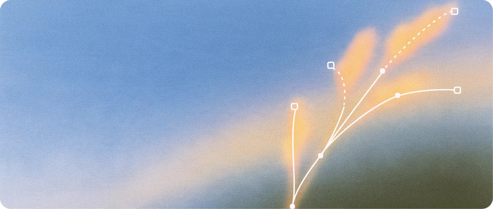

  

<h1 align="center">Sentient Foundation · Provenance Report</h1>

Click the title to read it on GitHub or download the PDF.

---

| Date | Report | PDF |
|---|---|---|
| November 2026 | **[Can You Prove Where an AI Model Came From?](2026-11-model-provenance/README.md)** Why model provenance must be designed as an adversarial-security system | [Download](2026-11-model-provenance/can-you-prove-where-an-ai-model-came-from.pdf) |
